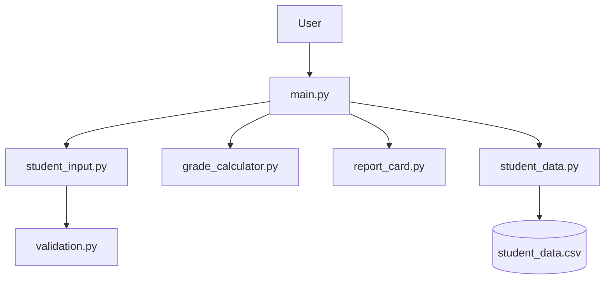
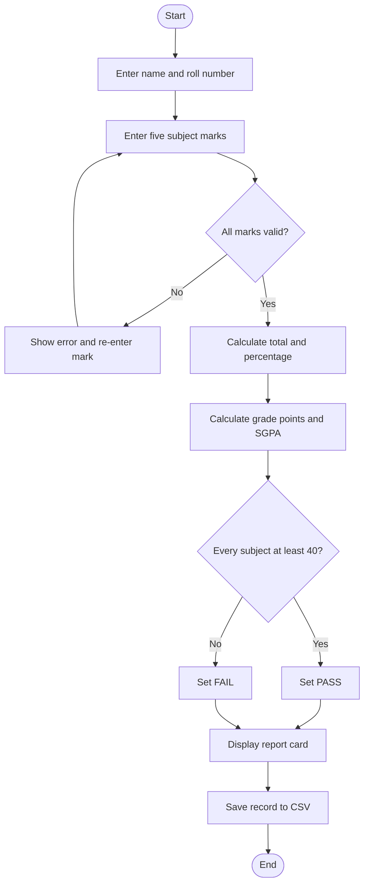
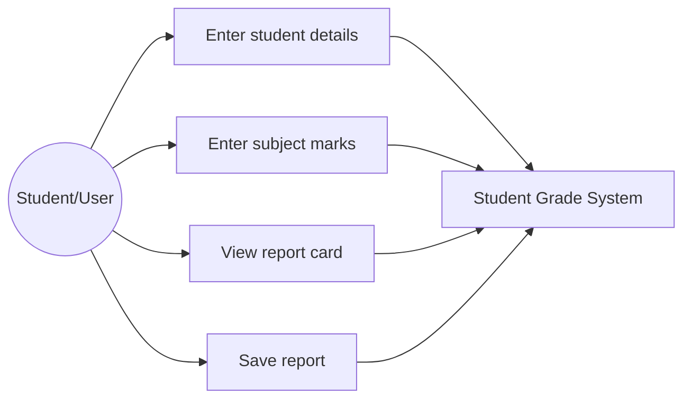
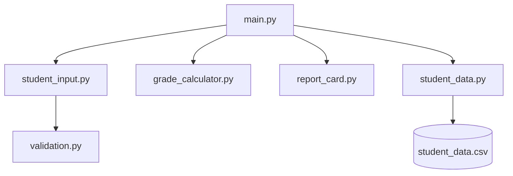
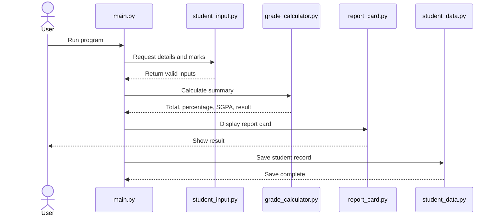

# Design and Documentation

## Objectives
Apply Python functions, modules, conditional statements, lists, calculations, validation, and CSV file handling in a grade-reporting application.

## Functional Requirements
1. Accept a student's name and roll number.
2. Accept marks for five named subjects.
3. Reject non-numeric marks and marks outside 0-100.
4. Calculate total marks and percentage.
5. Calculate grade points and SGPA using the documented scale.
6. Set PASS only if every subject mark is at least 40; otherwise set FAIL.
7. Display the report card.
8. Append the report to a CSV file.

## Non-Functional Requirements
- **Usability:** provide clear prompts and a readable report.
- **Reliability:** validate marks before calculations and use a consistent formula.
- **Maintainability:** separate input, validation, calculation, reporting, and storage.
- **Resource efficiency:** use the standard library and avoid unnecessary processing.
- **Portability:** support Python 3.8+ on common operating systems.

## System Architecture

## Process Workflow

## Use Case Diagram

## Component Diagram

## Sequence Diagram

## Storage Design
The project uses a CSV file named `student_data.csv`. Each row contains name, roll number, five subject marks, total, percentage, SGPA, and result. New records are appended, so previous entries remain available.

## Design Decisions and Rationale
- The command-line interface keeps the project easy to run.
- Calculation logic is separated from input and display logic.
- CSV storage is simple and supported by the Python standard library.
- The grade-point scale is explicit and easy to test.
- SGPA is calculated as the average of five grade points; official institutions may use credit-weighted calculations.

## Testing Approach
Unit tests check grade-point boundaries, a passing case, and a failing case. Manual testing should include valid marks, invalid text, out-of-range marks, and confirming that the CSV file is created and appended.

## Challenges
Important considerations include validating user-entered marks, applying the same grade scale consistently, and saving all calculated values in a structured format.

## Learnings
The project practices modular Python design, functions, lists, conditional logic, input validation, arithmetic calculations, CSV handling, and unit testing.

## Future Enhancements
- Add student search and record editing
- Add a menu to view previous reports
- Support subject credits for institution-specific SGPA
- Export formatted report cards
- Add a graphical interface
